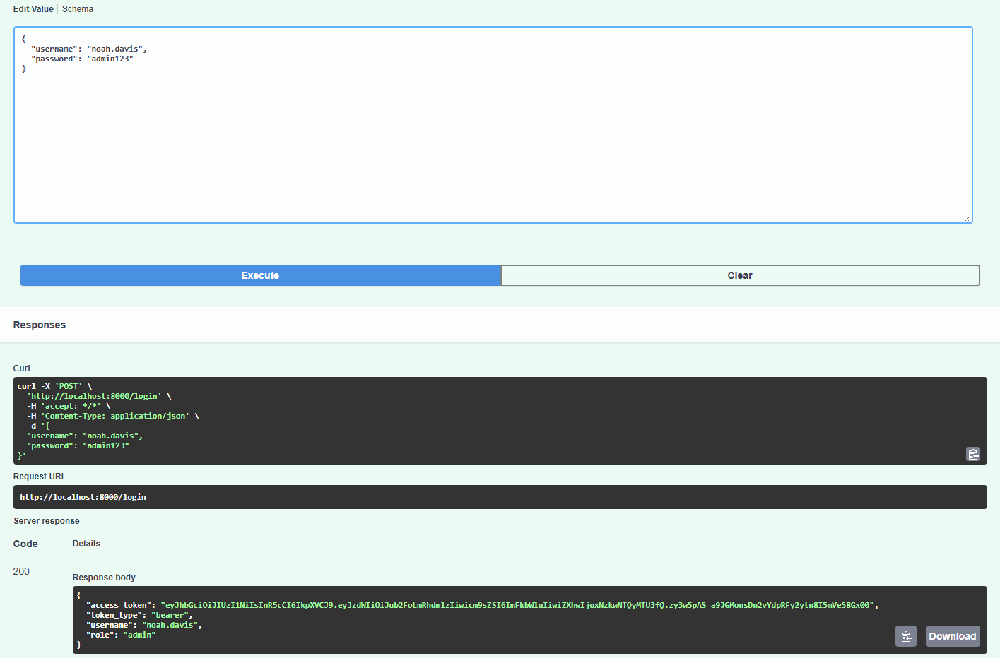
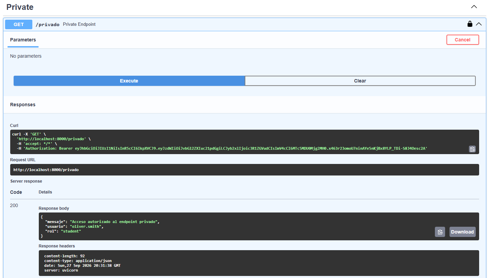
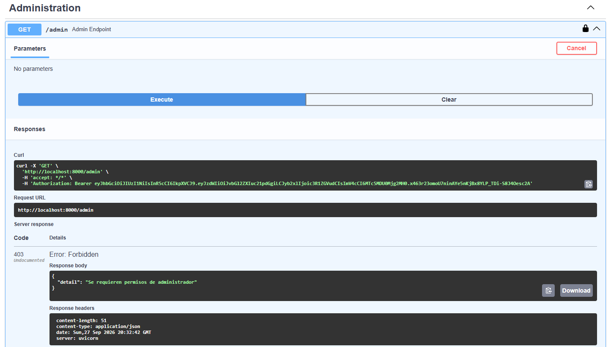

# Authentication API con FastAPI

Backend académico desarrollado con FastAPI. Incluye autenticación mediante JWT, contraseñas protegidas con Passlib y control de acceso por roles usando usuarios almacenados en `data/users.csv`.

## Estructura

- `main.py`: crea la aplicación y expone los endpoints.
- `auth.py`: contiene `hash_password`, `verify_password`, `create_token` y `get_current_user`.
- `data/users.csv`: almacena los cinco usuarios de prueba con sus contraseñas hasheadas.
- `.venv/`: entorno virtual local del proyecto.

## Instalación y ejecución

En PowerShell:

```powershell
.\.venv\Scripts\Activate.ps1
pip install -r requirements.txt
uvicorn main:app --reload
```

La API estará disponible en `http://127.0.0.1:8000`.

## Swagger

Abre `http://127.0.0.1:8000/docs` para probar los endpoints desde Swagger UI.

1. Ejecuta `POST /login` usando este JSON editable:

	 ```json
	 {
		 "username": "noah.davis",
		 "password": "admin123"
	 }
	 ```

2. Copia el `access_token` o utiliza el botón `Authorize`.
3. En la ventana de autorización de Swagger, introduce el token para que se envíe automáticamente como `Authorization: Bearer <TOKEN>`.
4. Prueba `/privado` y `/admin` con el token obtenido.

Los endpoints protegidos rechazan la solicitud si no reciben una cabecera `Authorization` válida con el formato `Bearer <TOKEN>`, o si el JWT está vencido, alterado o pertenece a un usuario inexistente.

## Usuarios de prueba

| Usuario | Contraseña | Rol |
| --- | --- | --- |
| `oliver.smith` | `student123` | `student` |
| `emma.johnson` | `student123` | `student` |
| `liam.williams` | `student123` | `student` |
| `sophia.brown` | `student123` | `student` |
| `noah.davis` | `admin123` | `admin` |

## Endpoints

- `POST /login`: autentica un usuario y devuelve un token JWT.
- `GET /publico`: endpoint disponible sin autenticación.
- `GET /privado`: requiere un token válido.
- `GET /admin`: requiere un token válido y rol `admin`.

## Capturas de Swagger

### Login exitoso



### Endpoint privado



### Endpoint de administración

